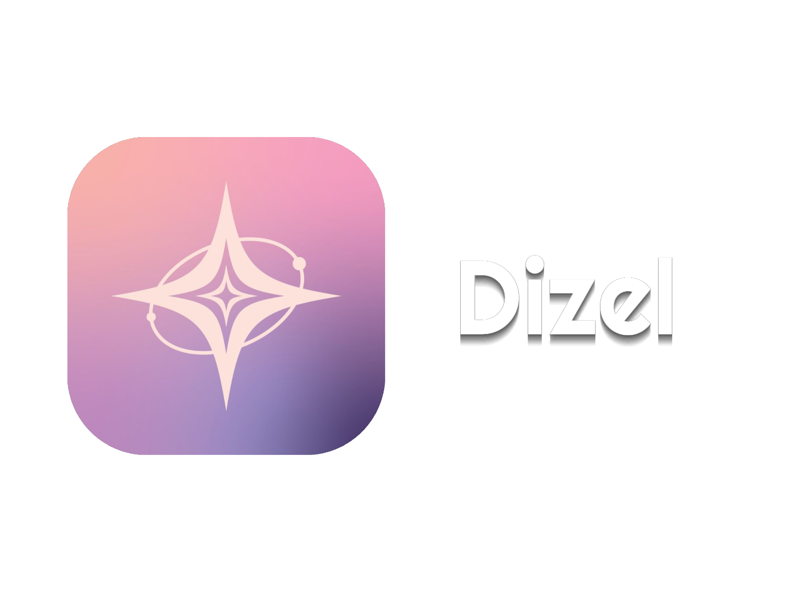

<div align="center">
  
</div>
<div align="center">


</div>

**Dizel** is a small language model built from scratch, plus the local software that runs it. The repository contains the model architecture, the training pipeline, a Textual terminal client, an Electron desktop app, and the FastAPI sidecar they share.

The app runs **Dizel 1.5** today. **Dizel 1.6 Flash Preview** is training in public; its weights are not published yet. The v1.5 dense model remains the control and the released artifact.

> **Status in one line:** v1.5 is shipped and published as F16. v1.6 Flash Preview is a 435.3M-parameter sparse MoE at step 5,000 of 45,777. Nothing from v1.6 is a release yet.

---

## Contents

- [Status](#status)
- [What's new](#whats-new)
- [What's coming](#whats-coming)
- [Quick start](#quick-start)
- [Using Dizel](#using-dizel)
- [Repository layout](#repository-layout)
- [Training](#training)
- [Architecture](#architecture)
- [Overfitting on small data](#overfitting-on-small-data)
- [VRAM guide](#vram-guide)
- [Extending Dizel](#extending-dizel)
- [FAQ](#faq)
- [References](#references)

---

## Status

| Track                       | Status                  | What it is                                                                                                                            |
| --------------------------- | ----------------------- | ------------------------------------------------------------------------------------------------------------------------------------- |
| **Dizel 1.5**               | **Shipped / published** | 454.78M dense decoder. 100K SentencePiece vocabulary, 2,048-token context, F16 GGUF, and the dense control for every v1.6 comparison. |
| **Dizel 1.6 Flash Preview** | **Training in public**  | 435.3M total / 293.7M active. Four-expert, top-2 dropless MoE. Qwen2.5 tokenizer, ChatML, 2,048-token context. Weights unpublished.   |
| **Dizel 1.6 Flash**         | **Gated**               | Same Flash architecture, refined checkpoint and post-training. The name is earned only after the six measured gates pass.             |
| **Dizel 1.6 Pro**           | **Future**              | A separate 1.6B total / 973M active, 8-expert top-4 tier. Configured, not trained. No artifact exists.                                |

### Current pretrain run

| Metric          | Value                                                       |
| --------------- | ----------------------------------------------------------- |
| Run             | `dizel-1.6-preview-m1-pretrain`                             |
| Progress        | 5,000 / 45,777 steps (10.9%)                                |
| Tokens          | 327.7M / 3B                                                 |
| Bits per byte   | **1.2057** on the fixed 500-document holdout                |
| Validation loss | 3.6998                                                      |
| Train loss      | 2.7982                                                      |
| Throughput      | ~21 s/step on the current T4 run                            |
| Checkpoint      | Best snapshot synced to Drive; local copy in `checkpoints/` |

The local `checkpoints/dizel-1.6-preview-m1-best.pt` is a **pretrain snapshot for evaluation**, not an instruct model. It has not been SFT'd, distilled, or released.

---

## What's new

### 1. The desktop app is Electron now (v2.0.0)

The PySide6 app is gone. `inference/gui/` is an Electron + React + TypeScript shell over the same Python engine. It talks to a FastAPI sidecar (`api/`) on `127.0.0.1` with a fresh per-launch token, so the window never imports torch and the HTTP surface is not reachable from another origin.

What shipped in the rewrite:

- Frameless window, tray icon, and a global `Ctrl+Shift+Space` summon hotkey.
- Streaming chat over SSE, markdown + GFM tables, syntax-highlighted code, copy/regenerate, stop generation.
- Thumb-up/down feedback on finished replies, with optional reasons and a free-form note stored locally in `data/feedback/feedback.jsonl` (or the packaged app's user-data equivalent).
- Session list from disk with rename, pin, archive, delete, search, import, and JSON export.
- Model loader with named stages and an elapsed counter instead of a fake percentage.
- Provider grid for hosted APIs, Ollama discovery, and any OpenAI-compatible endpoint.
- Settings for checkpoint, device, sampling, system prompt, appearance, speech, and shortcuts, plus a separate profile dialog.
- Voice dictation through Whisper, with automatic model download on first use.
- Context warning at 80% of the window, edit-and-resend, and handoff to a new chat.

### 2. The TUI is a real client, not a demo

`inference/tui/` is a Textual application with the same engine as the desktop app:

- Single-column chat, `Ctrl+T` session drawer, `Ctrl+R` context rail, `Ctrl+A` artifacts, `Ctrl+K` command palette.
- Slash commands for `/load`, `/model`, `/provider`, `/tier`, `/mode`, `/session`, `/context`, `/export`, `/settings`, and more.
- **Flash** / **Pro** tiers for Dizel checkpoints, and **Fast** / **Planning** / **Coding** / **Thinking** / **Deep Think** modes.
- Local checkpoints and remote providers in the same surface.
- Headless mode for scripts: `python -m inference.tui.main --prompt "..."`.

### 3. Checkpoint switching is serialized and observable

Both clients share `dizel_core/`:

- A load swaps the backend atomically under a lock; generation and loading cannot overlap.
- A failed load restores the previous model and header instead of leaving an empty runtime.
- `unload_model()` releases the backend cleanly.
- The TUI preloads `dizel_core.model_backend` and `llama_cpp` on the main thread before Textual starts, so the slow native import does not block the event loop.
- `.pt` checkpoints load memory-mapped on CPU and drop the training optimizer state, so a 5 GB pretrain checkpoint does not need 5 GB of resident RAM before the model is built.
- A 20-second load watchdog writes a thread dump to `logs/tui_load_stacks.log`; normal load progress goes to `logs/tui_load.log`.

### 4. v1.6 is a different model, not a bigger v1.5

v1.6 moves from a dense FFN to a **4-expert, top-2 dropless MoE**, switches to the **Qwen2.5 tokenizer**, and trains on **ChatML**. It keeps the same 2,048-token context and the same tied-embedding, RMSNorm, RoPE, GQA, SwiGLU backbone.

The checkpoint format and loader understand both generations. New v1.6 checkpoints default to ChatML, the Qwen tokenizer, and system prompts even when an older save lacks the metadata flags. v1.5 checkpoints keep their raw `<|role|>` path and SentencePiece tokenizer.

### 5. v1.5 is published as F16

The released v1.5 artifact is the **F16 GGUF** (`~1.1 GB`), plus the source `.pt` checkpoint, which the native loader can also run:

```bash
ollama run D4niel-dev/Dizel-1.5
```

Q4_K_M and Q8_0 conversions were evaluated and **rejected** for release. Do not present them as supported artifacts. The published tag is F16.

### 6. The docs are product-led

`docs/index.html` is now a landing page for the model and the app, not a feature dump. It states the Preview status plainly and shows the live pretrain numbers. `docs/demo.html` is a scripted browser replica of the desktop interface; it is not the model.

---

## What's coming

### v1.6 Flash Preview

The remaining path is fixed:

1. Finish Phase A pretraining: 45,777 steps / 3B tokens at 65,536 tokens per step.
2. Run SFT: 3,000 steps on the ChatML assistant-only mix.
3. Run token-level KD: 2,000 steps from `Qwen/Qwen2.5-0.5B-Instruct`, KL weight 0.5, temperature 2.0.
4. Run optional DPO: 1,000 steps, experimental.
5. Validate every resume and Drive save from a fresh runtime.
6. Run the fixed BPB, behavioral, safety, speed, and RAM checks.

The instruct build ships only after those stages. Preview publication also requires the plan's engineering checks: router health, safety, checkpoint resume, Drive sync, and a documented BPB/behavioral baseline.

### Stable Dizel 1.6 Flash: six gates

The stable name is allowed only when all six pass:

1. Router utilization is healthy for the final 1,000 steps; no expert below 5%.
2. BPB on the fixed byte-level holdout is not worse than v1.5.
3. The fixed behavioral suite is not worse than v1.5 on math, code, concision, and identity.
4. The safety red-team gate passes.
5. Tokens/sec and RAM are better than v1.5 on the same hardware.
6. Checkpoint save/reload and resume work from a fresh Colab runtime.

Preview does **not** have to beat v1.5; it records the baseline. If a stable gate fails, the name stays **Preview**. If a Preview engineering check fails, the build stays an experimental MoE and is not published.

### Pro, later

`Dizel 1.6 Pro` is a future 1.6B total / 973M active, 8-expert top-4 tier. Its architecture, 3B-token Phase A, and post-training defaults live in `configs/v16_pro.py` (`DIZEL_16_PRO_CONFIG`). No Pro run or artifact exists yet.

### Not planned for 1.6: vision

There is no vision encoder. The model is text-only. The desktop app's image and presentation workspaces are UI placeholders, not multimodal model features.

---

## Quick start

### Requirements

- **Python 3.10+**
- **PyTorch 2.1+** (CUDA strongly recommended for local inference and required for realistic training)
- **Node.js 18+** for the desktop app
- **Windows** for the `dizel.cmd` launcher; the Python modules run on macOS and Linux too
- Optional: an NVIDIA GPU with a current CUDA build of `llama-cpp-python` for GGUF acceleration

### Install

```bash
git clone https://github.com/D4niel-dev/Dizel.git
cd Dizel

python -m venv .venv
# Windows:
.venv\Scripts\activate
# macOS / Linux:
# source .venv/bin/activate

# Install PyTorch for your CUDA version first (example: CUDA 12.1)
pip install torch --index-url https://download.pytorch.org/whl/cu121

pip install -r requirements.txt
```

`requirements.txt` includes the runtime dependencies for both clients and the API sidecar. Training-only packages are listed as optional comments at the bottom.

For GPU-accelerated GGUF inference, reinstall `llama-cpp-python` with CUDA enabled:

```bat
set CMAKE_ARGS=-DGGML_CUDA=on
pip install llama-cpp-python --upgrade --force-reinstall --no-cache-dir
```

### Configure the Hugging Face token (training only)

The v1.6 path downloads the Qwen tokenizer and, for KD, the Qwen teacher. Put the token in `.env` at the repository root:

```dotenv
HF_TOKEN=hf_your_token_here
```

`.env` is ignored by git. The training code loads `HF_TOKEN` without printing it. Never paste the token into a notebook cell, a log, or a commit.

### Launch

```bat
dizel
```

Choose:

1. **Terminal UI** — keyboard-first, lives in the shell.
2. **Desktop app** — full window, animations, voice input.

Or start either client directly:

```bash
# Terminal UI
python -m inference.tui.main --checkpoint checkpoints/dizel15/dizel-v15-distill-best.pt --device cuda

# Desktop app (first run installs npm dependencies)
cd inference/gui
npm install
npm run dev
```

The desktop app auto-detects a Python interpreter that can import FastAPI. Override it with `DIZEL_PYTHON` if needed:

```bash
DIZEL_PYTHON="C:/path/to/python.exe" npm run dev
```

### Headless generation

```bash
python -m inference.tui.main \
  --checkpoint checkpoints/dizel15/dizel-v15-distill-best.pt \
  --device cuda \
  --prompt "Explain what a for loop does in one paragraph."
```

Tokens go to stdout; loader and error messages go to stderr.

### Checkpoints in this repository

| File                                            | Purpose                                                                                      |
| ----------------------------------------------- | -------------------------------------------------------------------------------------------- |
| `checkpoints/dizel15/dizel-v15-distill-best.pt` | v1.5 distillation student in PyTorch format; unmerged LoRA adapters are folded at load time. |
| `checkpoints/Dizel-1.5-Distill.gguf`            | Published F16 GGUF for llama.cpp / Ollama.                                                   |
| `checkpoints/Dizel-1.5-SFT.gguf`                | F16 SFT GGUF.                                                                                |
| `checkpoints/dizel-1.6-preview-m1-best.pt`      | v1.6 pretrain snapshot for evaluation; **not** an instruct release.                          |

The loader accepts `.pt`, `.pth`, `.gguf`, `.safetensors`, `.bin`, and `.ckpt`. When a v1.5 `.pt` still contains unmerged LoRA adapters, `dizel_core.model_backend` folds them in memory with `model/lora_merge.py` before building the plain `DizelLM`. Standalone scripts that build the model themselves must do the same fold.

---

## Using Dizel

### Local inference

| Format         | Backend                                                   | Notes                                                                                   |
| -------------- | --------------------------------------------------------- | --------------------------------------------------------------------------------------- |
| `.pt` / `.pth` | Native PyTorch (`dizel_core.model_backend.NativeBackend`) | Loads v1.1, v1.2, v1.5, and v1.6 checkpoints by inspecting the state dict.              |
| `.safetensors` | Native PyTorch (`SafeTensorsBackend`)                     | Same model path, memory-mapped weights.                                                 |
| `.gguf`        | `llama-cpp-python` (`GGUFBackend`)                        | v1.5 GGUFs use the `qwen2` llama.cpp architecture and the Dizel `<\|role\|>` chat path. |

CPU works for all three. CUDA is selected with `--device cuda` in the TUI or the device control in Settings.

### Model switching and loader behavior

- Loading is **atomic**: the new backend is built off to the side and swapped in only when ready.
- Loading is **exclusive** with generation: the TUI refuses a load while a reply is streaming.
- A failed load **restores the previous model** and the previous header label.
- `unload_model()` releases the backend and clears the runtime.
- The TUI preloads the heavy native modules before Textual starts. A slow first load looks like a slow start, not a frozen interface.
- If a load emits no progress for 20 seconds, the watchdog dumps all thread stacks to `logs/tui_load_stacks.log`. Send that file with `logs/tui_load.log` when reporting a stall.

### Tiers and modes

The app exposes the v1.6 naming today, even while running v1.5:

- **Tiers:** `Flash` (the small, fast tier; what this build ships) and `Pro` (the larger tier; same prompts until that build exists). Tiers are shown only for Dizel checkpoints; Mila and other local models go straight to modes.
- **Modes:** `Fast` (answer-first, temp 0.55), `Planning` (plan, risks, then execute, temp 0.45), `Coding` (runnable code first, temp 0.25), `Thinking` (reason in a `think` block, temp 0.40), and `Deep Think` (long-form reasoning and structure, temp 0.50).

Modes change sampling, token budget, and the system prompt. They do not change the weights. Non-Dizel local checkpoints use their own generic/Mila profile family, never the Dizel prompt.

### Providers

The local model is one provider among many:

- **Local (Dizel)** — native `.pt` / `.safetensors` / GGUF.
- **Ollama** — discovers models from a local Ollama server.
- **Hosted APIs** — OpenAI, Anthropic, Google Gemini, Groq, Mistral AI, xAI, AI21 Labs, Azure OpenAI, Cohere, and Meta (Llama).
- **Custom Provider** — any OpenAI-compatible base URL and key.

API keys are encrypted locally before they are written to `.dizel/settings.json`. The desktop sidecar binds loopback only and requires `X-Dizel-Token` on every route except `/api/health`. Shell and Python execution routes are disabled over HTTP unless the sidecar is started with `DIZEL_ALLOW_SHELL=1`.

### Sessions, context, and usage

- Chats are JSON files in `data/history/`.
- Settings are in `.dizel/settings.json`.
- `ContextTrimmer` drops the oldest turns when the window fills, protects the system prompt and the most recent turns, and falls back to an extractive summary note.
- `UsageManager` tracks a 12-hour compute window and allows five compactions per window.
- The status bar shows generation state, context tokens, and the output budget. The composer footer shows the active model, provider, and tier.

### Voice (desktop only)

The desktop app records 16 kHz WAV, posts it to `/api/nova/transcribe`, and inserts the transcript into the composer. If no Whisper checkpoint is on disk, pressing the mic starts the ~145 MB download, streams to a `.part` file, and renames on completion. The TUI has no voice input.

### Keyboard

| Key                 | Action                             |
| ------------------- | ---------------------------------- |
| `Ctrl+C`            | Interrupt generation / quit        |
| `Esc`               | Interrupt, or close an overlay     |
| `Ctrl+K` / `Ctrl+F` | Command palette / all commands     |
| `Ctrl+T`            | Session drawer                     |
| `Ctrl+R`            | Context rail                       |
| `Ctrl+Y`            | Multi-line input                   |
| `Ctrl+A`            | Artifacts                          |
| `Ctrl+L`            | Clear the workspace                |
| `Tab`               | Cycle modes (TUI)                  |
| `Ctrl+Shift+Space`  | Summon the desktop window (global) |

The desktop app also supports `Ctrl+N` (new chat), `Ctrl+B` (sidebar), `Ctrl+,` (settings), and `Ctrl+K` (focus composer) inside the window.

### Web demo

- Landing page: [d4niel-dev.github.io/Dizel](https://d4niel-dev.github.io/Dizel/)
- Interface demo: [d4niel-dev.github.io/Dizel/demo.html](https://d4niel-dev.github.io/Dizel/demo.html)

The browser demo is a **scripted replica** of the desktop UI. It does not run the model. Local inference requires the Python app.

---

## Repository layout

```text
Dizel/
├── config.py                    # v1.2 and v1.5 configs, shared training defaults
├── configs/
│   ├── v16_flash.py             # v1.6 Flash architecture, tokenizer, SFT/KD/DPO, release identity
│   └── v16_pro.py               # v1.6 Pro architecture (8 experts, top-4), pretrain/post-training defaults
│
├── model/
│   ├── architecture.py          # DizelLM: RMSNorm + GQA + SwiGLU + RoPE
│   ├── moe.py                   # dropless top-k MoE block and router
│   ├── rope.py                  # rotary position embeddings
│   ├── registry.py              # model family registry
│   ├── naming.py                # checkpoint filename -> display name
│   └── lora_merge.py            # fold v1.5 LoRA adapters (used by the loader)
│
├── training/
│   ├── pretrain.py              # v1.5 dense pretraining
│   ├── sft.py                   # v1.5 SFT
│   ├── distill.py               # v1.5 LoRA distillation
│   ├── dpo.py                   # v1.5 experimental DPO
│   ├── pretrain_v16.py          # v1.6 MoE pretraining (--config flash|pro; BPB, RNG, dataset position, Drive sync)
│   ├── sft_v16.py               # v1.6 ChatML SFT
│   ├── distill_v16.py           # v1.6 token-level KD
│   ├── dpo_v16.py               # v1.6 experimental DPO
│   ├── posttrain_common_v16.py  # resumable batch stream, optimizer, AMP
│   ├── posttrain_checkpoint_v16.py
│   ├── posttrain_data_v16.py    # ChatML formatting and datasets
│   ├── tokenizer_qwen.py        # Qwen2.5 tokenizer wrapper
│   ├── dataset.py               # pretrain/SFT datasets
│   ├── pretokenized.py          # packed uint32 shard loader
│   ├── shard_utils.py           # corpus sharding
│   ├── cache_utils.py           # per-shard token cache
│   └── data_mixing.py           # dataset mixing
│
├── pipelines/
│   ├── download_v15_data.py     # v1.5 source download
│   ├── clean_v15_data.py        # v1.5 cleaning
│   ├── format_v15_data.py       # v1.5 pretrain/SFT/distill formatting
│   ├── generate_math_v15.py     # synthetic math
│   ├── generate_safety_v15.py   # safety examples
│   ├── prepare_v16_data.py      # 3B-token Phase A corpus: holdout, tokenize, mix, verify, upload
│   └── prepare_v16_posttrain.py # SFT/KD/DPO mixes by token budget
│
├── dizel_core/                  # shared engine for both clients
│   ├── chat_manager.py          # atomic load/swap, generation guard, unload
│   ├── model_backend.py         # native, safetensors, GGUF backends
│   ├── config_manager.py        # settings + encrypted API keys
│   ├── history_manager.py       # JSON chat sessions
│   ├── context_trimmer.py       # window trimming + extractive summary
│   ├── token_budget.py          # adaptive output budget
│   ├── usage_manager.py         # 12-hour compute window
│   ├── core_integration.py
│   └── tutorial_manager.py
│
├── api/
│   ├── main.py                  # FastAPI sidecar, version 2.0.0
│   ├── security.py              # loopback token auth, origin allowlist
│   ├── routes/                  # chat, config, health, memory, models, nova, profile, providers, session
│   └── services/                # chat, config, memory, session wrappers
│
├── inference/
│   ├── tui/                     # Textual terminal client
│   │   ├── main.py              # python -m inference.tui.main
│   │   ├── app.py               # runtime, bindings, loader lifecycle
│   │   ├── constants.py         # Flash/Pro, modes, provider fallbacks
│   │   ├── runtime_actions.py
│   │   ├── state.py / theme.py
│   │   ├── bridge/              # streaming, sessions, tools
│   │   ├── commands/            # slash command registry + builtins
│   │   ├── panels/              # top bar, composer, session/context/artifact panels
│   │   ├── rendering/           # message, tool, status, empty state
│   │   └── cmd_ui.tcss
│   │
│   └── gui/                     # Electron + React + TypeScript desktop app
│       ├── electron/            # main process, preload, sidecar supervisor
│       ├── src/                 # React renderer, components, store, services
│       ├── public/              # icons and static assets
│       └── package.json         # v2.0.0; npm run dev / build / dist
│
├── tokenizer/
│   ├── dizel_v15.model          # 100K SentencePiece BPE, byte fallback
│   ├── dizel_v15.vocab
│   ├── qwen2.5/                 # local Qwen2.5 tokenizer files
│   ├── train_tokenizer.py       # legacy 32K tokenizer trainer
│   └── train_mila_tokenizer.py
│
├── scripts/
│   ├── convert_to_gguf.py       # .pt -> GGUF (v1.5 layout)
│   ├── convert_to_safetensors.py
│   ├── eval_holdout_bpb.py      # fixed byte-level holdout BPB
│   ├── smoke_test_v16.py        # architecture/router/checkpoint smoke tests
│   ├── test_model_lifecycle.py  # load/swap/failure/unload regression tests
│   ├── test_inference_backend.py
│   ├── push_to_hub.py           # Hugging Face release helper
│   ├── publish_ollama_readme.py
│   └── snap_tui.py              # headless TUI screenshots
│
├── data/
│   ├── english.md               # small seed corpus
│   └── v16/                     # packed corpus: train/, val/, holdout/, posttrain/
│
├── checkpoints/                 # local weights (gitignored)
├── docs/                        # landing page + browser demo
├── evaluation/                  # benchmark runner, scorer, reports
├── utils/                       # verify.py, data_cleaner.py, test_model.py
├── core/                        # optional tools, memory, generation modes
├── sft_data/                    # legacy v1.2 SFT sample
├── dizel.cmd                    # Windows launcher (TUI or desktop)
├── requirements.txt
└── README.md
```

`sft_data/` is a legacy v1.2 sample. `core/` still provides the optional tool, memory, and generation-mode modules that `dizel_core/` imports lazily; it is not the model engine.

---

## Training

There are two paths. They share the data tooling, display helpers, and checkpoint discipline, but they are not interchangeable.

### v1.5 dense control

v1.5 is the released model and the comparison baseline. Its config lives in `V15_CONFIG` in `config.py`.

| Setting       | Value                                    |
| ------------- | ---------------------------------------- |
| Parameters    | 454,779,904 unique (~454.78M)            |
| Layers        | 28                                       |
| Hidden size   | 1,024                                    |
| Attention     | 16 heads, 8 KV heads (GQA), head dim 64  |
| Feed-forward  | SwiGLU, 3,072                            |
| Normalization | RMSNorm, eps 1e-6                        |
| Position      | RoPE, theta 10,000                       |
| Context       | 2,048                                    |
| Vocabulary    | 100,000 SentencePiece BPE, byte fallback |
| Embeddings    | Tied input/output                        |
| Dropout       | 0.0                                      |

The published `.pt` is the distillation student. Distillation saves LoRA unmerged, so the app's loader folds those adapters in memory before building the plain `DizelLM`. Any script that builds `DizelLM` directly must call `model/lora_merge.py` first.

Typical v1.5 commands:

```bash
# Data
python pipelines/download_v15_data.py --source pretrain
python pipelines/clean_v15_data.py --input data/raw --output data/cleaned --all
python pipelines/format_v15_data.py --mode pretrain

# Pretrain
python training/pretrain.py \
  --data_path data/formatted/v15_pretrain.txt \
  --max_steps 15000 \
  --lr 2e-4 --min_lr 2e-5 --warmup_steps 500 \
  --batch_size 2 --grad_accum 16 \
  --gradient_checkpointing

# SFT
python training/sft.py \
  --base_checkpoint checkpoints/dizel-v15-pretrain-best.pt \
  --sft_data data/formatted/v15_sft.jsonl \
  --max_steps 10000 \
  --lr 1e-4 --min_lr 1e-5 \
  --batch_size 2 --grad_accum 16 \
  --gradient_checkpointing

# Distillation (needs HF_TOKEN for the Qwen teacher)
python training/distill.py \
  --base_checkpoint checkpoints/dizel-v15-sft-best.pt \
  --data_path data/formatted/v15_distill.jsonl \
  --max_steps 5000 \
  --kl_weight 0.5 --temperature 2.0
```

v1.5 runs save `{run_name}-best.pt`, `{run_name}-final.pt`, and periodic `{run_name}-step{N}.pt`. v1.6 saves `-best`, `-last`, and `-final`, with one rotated `-milestone-step{N}.pt` during pretraining. Resume with `--resume <path>`.

### v1.6 Flash Preview training

v1.6 is the MoE path. The single source of truth is `configs/v16_flash.py` (`DIZEL_16_FLASH_CONFIG`).

| Setting                   | Value                                                    |
| ------------------------- | -------------------------------------------------------- |
| Total parameters          | 435,284,736 (~435.3M)                                    |
| Active parameters / token | 293,726,976 (~293.7M)                                    |
| Layers                    | 20                                                       |
| Hidden size               | 768                                                      |
| Attention                 | 12 heads, 6 KV heads (GQA), head dim 64                  |
| Experts                   | 4 per layer, top-2, dropless                             |
| Expert hidden             | 1,536                                                    |
| Router                    | float32 logits, aux 0.01, z-loss 0.001                   |
| Normalization             | RMSNorm, eps 1e-6                                        |
| Position                  | RoPE, theta 10,000                                       |
| Context                   | 2,048                                                    |
| Vocabulary                | Qwen2.5, 151,936 embedding rows; tokenizer emits 151,665 |
| Chat format               | ChatML                                                   |
| Embeddings                | Tied input/output                                        |
| Dropout                   | 0.0                                                      |

#### 1. Build the Phase A corpus

```bash
python pipelines/prepare_v16_data.py --stage all --target-tokens 3B
```

This builds the fixed 500-document holdout, tokenizes the sources with the Qwen tokenizer, mixes them to the target token count, verifies the packed shards, and can upload them to Drive with `--drive-dir` or `--rclone-remote`. The output is `data/v16/` with `train/`, `val/`, `holdout/`, `manifest.json`, and checksums.

#### 2. Pretrain

```bash
python training/pretrain_v16.py \
  --tokenized_data_dir data/v16 \
  --batch_size 2 --grad_accum 16
```

That is 65,536 tokens per optimizer step: `2 × 16 × 2,048`. The run is 45,777 steps, 3B tokens, bf16, with gradient checkpointing.

Resume:

```bash
python training/pretrain_v16.py \
  --tokenized_data_dir data/v16 \
  --resume checkpoints/dizel-1.6-preview-m1-best.pt \
  --batch_size 1 --grad_accum 32
```

The explicit path must exist. If it does not, the trainer raises `FileNotFoundError` instead of silently starting a fresh run. Resume restores the model, optimizer, scaler, RNG state, dataset position, and scheduler phase. `batch_size=1` with `grad_accum=32` keeps the same 65,536-token step when VRAM is tight.

#### 3. Build the post-training mixes

```bash
python pipelines/prepare_v16_posttrain.py --stage all
```

The SFT mix is selected by assistant/loss tokens, not sample count:

| Family           | Share |
| ---------------- | -----:|
| Detailed answers | 25%   |
| Concise answers  | 20%   |
| Conversation     | 15%   |
| Code             | 15%   |
| Math             | 10%   |
| Reasoning        | 5%    |
| Safety           | 7%    |
| Identity         | 3%    |

Current artifacts:

| File                               | Size                              |
| ---------------------------------- | --------------------------------- |
| `data/v16/posttrain/sft.jsonl`     | 84,701 records / 9,880,701 tokens |
| `data/v16/posttrain/distill.jsonl` | 42,873 records / 5,000,041 tokens |
| `data/v16/posttrain/dpo.jsonl`     | 9,975 pairs                       |

#### 4. SFT

```bash
python training/sft_v16.py \
  --base_checkpoint checkpoints/dizel-1.6-preview-m1-best.pt \
  --data data/v16/posttrain/sft.jsonl \
  --max_steps 3000
```

ChatML, assistant-only loss, max length 1,024, batch 2, lr 2e-5, cosine decay to 2e-6.

#### 5. Token-level KD

```bash
python training/distill_v16.py \
  --base_checkpoint checkpoints/dizel-1.6-preview-m1-sft/dizel-1.6-preview-m1-sft-final.pt \
  --data data/v16/posttrain/distill.jsonl \
  --max_steps 2000
```

The teacher is `Qwen/Qwen2.5-0.5B-Instruct`, KL weight 0.5, temperature 2.0, batch 1, lr 1e-5. Unlike v1.5, v1.6 shares Qwen's vocabulary, so the teacher and student logits align directly and the student stays a plain, checkpoint-compatible model. No LoRA is used.

#### 6. Optional DPO

```bash
python training/dpo_v16.py \
  --base_checkpoint checkpoints/dizel-1.6-preview-m1-distill/dizel-1.6-preview-m1-distill-final.pt \
  --data data/v16/posttrain/dpo.jsonl \
  --max_steps 1000
```

DPO is experimental. Beta 0.5, label smoothing 0.05, max length 1,536, max prompt 768, lr 5e-6. The reference checkpoint defaults to the base checkpoint, so this run freezes the KD result.

### Resume rules

All three v1.6 post-training scripts and the pretrainer follow the same contract:

- `--resume <path>` restores model weights, optimizer state, AMP scaler, RNG state, and the resumable batch position.
- A missing explicit `--resume` path raises `FileNotFoundError`. The trainer never treats a typo as "start over".
- A fresh run requires `--base_checkpoint` (or, for pretraining, a data source).
- Checkpoints carry architecture, tokenizer, and config hashes. A mismatch is rejected instead of loaded with `strict=False` and silently corrupted.

### Colab and Drive rules

- Run training from `/content`, **not** from the mounted Drive folder. Drive I/O is too slow and too flaky for tokenized shard reads.
- Upload only the packed corpus and training-only code to the runtime.
- Keep exactly **one active training runtime** writing to a shared checkpoint folder. Two writers will overwrite each other's `last`/`best` state.
- Save locally first, then sync to Drive. Verify the Drive copy before deleting the runtime.
- Use `.env` `HF_TOKEN`; never print it, log it, or commit it.

### Release policy

- v1.6 lives on the main tree behind `configs/v16_flash.py` and `training/*_v16.py`. There is no separate `v1.6/` fork.
- Preview ships first. The stable Flash name is a separate, gated decision.
- Publish only smoke-tested artifacts. A checkpoint that has not passed save/reload/resume on a fresh runtime is not a release.
- The v1.5 F16 `latest` stays published. Q4_K_M and Q8_0 remain rejected.

### Evaluation

```bash
# v1.6 on the fixed holdout
python scripts/eval_holdout_bpb.py \
  --checkpoint checkpoints/dizel-1.6-preview-m1-best.pt \
  --holdout data/v16/holdout/wikipedia.jsonl.gz \
  --tokenizer tokenizer/qwen2.5/tokenizer.json \
  --json-out runs/v16_holdout_bpb.json

# v1.5 control on the same holdout
python scripts/eval_holdout_bpb.py \
  --checkpoint checkpoints/dizel15/dizel-v15-distill-best.pt \
  --holdout data/v16/holdout/wikipedia.jsonl.gz \
  --json-out runs/v15_holdout_bpb.json
```

BPB is computed on raw UTF-8 bytes, so it is comparable across the 100K SentencePiece and 151,936-row Qwen vocabularies. Raw token cross-entropy is **not** comparable across tokenizers.

Run the architecture and router smoke tests before a long run:

```bash
python scripts/smoke_test_v16.py
python scripts/test_model_lifecycle.py
python scripts/test_inference_backend.py
```

---

## Architecture

Dizel is a decoder-only causal Transformer. Both generations use pre-RMSNorm, RoPE, GQA, SwiGLU, tied embeddings, and PyTorch 2.x scaled dot-product attention. v1.6 replaces the dense FFN with a sparse MoE block.

### Attention (GQA + RoPE)

```text
x (B, T, d_model)
   │
   ├─ RMSNorm
   │
   ├─ Q = Linear(d_model → n_heads × head_dim)
   ├─ K = Linear(d_model → n_kv_heads × head_dim)
   ├─ V = Linear(d_model → n_kv_heads × head_dim)
   │
   ├─ RoPE(Q, K)
   │
   ├─ SDPA(causal, GQA)
   │
   └─ Linear(d_model → d_model) → + residual
```

v1.5 uses 16 query heads and 8 KV heads at `d_model=1024`. v1.6 uses 12 query heads and 6 KV heads at `d_model=768`. GQA cuts the KV cache while keeping the query capacity.

### Dense block (v1.5)

```text
x → RMSNorm → GQA attention → + → RMSNorm → SwiGLU(1024 → 3072 → 1024) → +
```

### MoE block (v1.6)

```text
x → RMSNorm → router logits (d_model × 4, float32)
                    │
                    ├─ top-2 experts
                    │     expert_i: SwiGLU(768 → 1536 → 768)
                    │
                    └─ weighted sum → + residual
```

The router is **dropless**: every token is processed by its top two experts; no token is dropped for capacity. The auxiliary loss (0.01) and router z-loss (0.001) encourage balanced expert use. The router logits stay in float32 for stability.

All four experts are stored in memory even though only two fire per token. That is the trade: **435.3M total parameters of capacity, 293.7M active parameters of compute per token.**

### Why these choices

**SwiGLU.** The gated MLP from Llama-family models gives better quality per parameter than a plain ReLU/GELU FFN. v1.6 applies it per expert.

**Pre-RMSNorm.** RMSNorm before each sub-layer is stable with AdamW and avoids the warm-up sensitivity of post-LayerNorm. It also removes the mean-centering cost of LayerNorm.

**RoPE.** Rotary position embeddings encode relative position and keep the parameter count flat. Both models use theta 10,000 and a 2,048-token window.

**GQA.** Grouped-query attention shares K/V heads across query groups. It reduces KV-cache size and memory bandwidth without collapsing to single-head MQA.

**Tied embeddings.** The input embedding and LM head share weights. For v1.5 that removes ~102M duplicate parameters; for v1.6 it removes ~117M. The GGUF writer may serialize the tied tensor twice, which is why some tools display a larger parameter count than the unique total.

**MoE.** A dense 435M model would cost 435M parameters of compute per token. The top-2 router spends 294M and keeps the rest as stored capacity. At this scale the expected win is modest; measuring it is what the v1.6 gates are for.

**No vision.** There is no image encoder, no image tokens, and no multimodal projection. Adding one would be a new model, not a v1.6 checkpoint.

### Parameter accounting

| Model                   | Total   | Active / token | Embedding             | Layers | d_model | Q / KV heads | FFN                      |
| ----------------------- | -------:| --------------:| ---------------------:| ------:| -------:| ------------:| ------------------------ |
| Dizel 1.5               | 454.78M | 454.78M        | 100,000 × 1,024, tied | 28     | 1,024   | 16 / 8       | SwiGLU 3,072             |
| Dizel 1.6 Flash Preview | 435.3M  | 293.7M         | 151,936 × 768, tied   | 20     | 768     | 12 / 6       | 4 experts × 1,536, top-2 |

The v1.6 count includes every expert. The active count includes the embeddings, attention, norms, router, and the two selected experts per layer.

---

## Overfitting on small data

Small corpora are the main failure mode when training a language model from scratch. The v1.5 and v1.6 training runs use dropout 0.0 because the data volume is large enough; the regularizers below do the work instead.

| Technique                           | Where                             | Effect                                                               |
| ----------------------------------- | --------------------------------- | -------------------------------------------------------------------- |
| **Weight decay 0.1**                | AdamW                             | Keeps weights small; applied to matrices, not norms or biases.       |
| **Window reshuffling**              | DataLoader, every 500 steps       | Breaks repeated mini-batch order.                                    |
| **Overlapping windows**             | `PretrainDataset`, stride = ctx/2 | Gets more training signal from the same text.                        |
| **Gradient clipping 1.0**           | Optimizer                         | Prevents loss spikes from destabilizing the run.                     |
| **Cosine LR + warmup**              | Scheduler                         | Smooth decay; 500–1,000 warmup steps for the long runs.              |
| **Gradient accumulation**           | Training loop                     | Effective batch of 65,536 tokens per step on one T4.                 |
| **Fixed holdout + best checkpoint** | Evaluation                        | Model selection on a stable 500-document set, not the training loss. |
| **Router aux + z-loss**             | v1.6 MoE                          | Prevents expert collapse and router overconfidence.                  |

For tiny experimental configs, raising dropout to 0.1–0.2 is reasonable. Do not change it in a published-run config and compare the result as if only one variable moved.

If validation loss plateaus early:

1. Add more clean data. This is the only real fix.
2. Check the tokenizer and the holdout before changing the model.
3. Scale the model down before scaling the batch up.

---

## VRAM guide

The numbers below are practical starting points, not guarantees. Activation memory dominates training; KV cache and context length dominate inference.

| Model                   | Params                       | Published artifact                       | Inference                  | Training                                                 |
| ----------------------- | ----------------------------:| ---------------------------------------- | -------------------------- | -------------------------------------------------------- |
| Dizel v1.2              | ~205M                        | `.pt`                                    | ~1 GB                      | ~4–6 GB                                                  |
| Dizel 1.5               | 454.78M                      | F16 GGUF ~1.1 GB; `.pt` ~2.0 GB          | ~1.5–2.5 GB incl. KV cache | 16 GB T4 with batch 2 × 2,048 + gradient checkpointing   |
| Dizel 1.6 Flash Preview | 435.3M total / 293.7M active | `.pt` ~5.2 GB (includes optimizer state) | ~1.5–2.5 GB incl. KV cache | 16 GB T4 with batch 1–2 × 2,048 + gradient checkpointing |

The 5.2 GB v1.6 checkpoint is a **training snapshot** with optimizer state. It is not the inference footprint.

If you hit CUDA OOM:

1. Reduce `batch_size` first.
2. Reduce `context_length` or `max_length`.
3. Enable gradient checkpointing.
4. For inference, use the GGUF F16 build and lower the context.
5. Close other GPU consumers before changing the model.

---

## Extending Dizel

### Change the architecture

Edit `config.py` for v1.2/v1.5 or `configs/v16_flash.py` for v1.6. `d_model` must be divisible by `n_heads`; `n_heads` must be divisible by `n_kv_heads`.

### Add training data

- v1.5: add cleaned text to `data/formatted/v15_pretrain.txt`, or add JSONL records for SFT/distill.
- v1.6: add sources to `pipelines/prepare_v16_data.py` and rebuild the packed corpus. Do not hand-edit `data/v16/train/` shards.
- Post-training: add records to the source datasets and rerun `pipelines/prepare_v16_posttrain.py`.

### Add a provider

Add the provider to `api/routes/providers.py` and `dizel_core`'s provider registry, then wire the key form in `inference/gui/src/components/SettingsDialog.tsx`. The sidecar validates the key and model list; the renderer never talks to the provider directly.

### Export

```bash
# GGUF for llama.cpp / Ollama
python scripts/convert_to_gguf.py \
  --checkpoint checkpoints/dizel15/dizel-v15-distill-best.pt \
  --tokenizer tokenizer/dizel_v15.model

# safetensors + Hugging Face config
python scripts/convert_to_safetensors.py \
  --checkpoint checkpoints/dizel15/dizel-v15-distill-best.pt \
  --tokenizer tokenizer/dizel_v15.model
```

The v1.5 GGUF uses the `qwen2` architecture identifier for llama.cpp compatibility. It is **not** a Qwen model or a Qwen fine-tune; Qwen2.5-0.5B-Instruct was only the distillation teacher.

### Do not add a vision path to 1.6

The 1.6 plan is text-only. A vision encoder would change the architecture, tokenizer, data, and evaluation contract. Treat it as a future model, not a feature flag.

---

## FAQ

**Can I run Dizel 1.6 today?**  
No. The app runs v1.5. The v1.6 weights are unpublished. A local pretrain snapshot exists for evaluation, but it is not an instruct model.

**Is Dizel 1.6 a Qwen fine-tune?**  
No. v1.6 uses the Qwen2.5 tokenizer and Qwen2.5-0.5B-Instruct as a distillation teacher. The architecture, weights, training run, and identity are Dizel's.

**Why does Ollama show ~557M parameters for a 454.78M model?**  
The tied input/output embedding is serialized twice in the GGUF. The unique parameter count is **454,779,904** (~454.78M). The Ollama model card documents the difference.

**Why is v1.6 smaller than v1.5 but called more capable?**  
It is not necessarily more capable yet. v1.6 trades dense parameters for sparse capacity: 435.3M stored, 293.7M active per token. Whether that wins is what the gates measure.

**Where are my settings and chats?**  
Settings: `.dizel/settings.json`. Chats: `data/history/*.json`. API keys are encrypted before storage.

**How do I switch checkpoints?**  
TUI: `/load` or `/model`. Desktop: Settings → Chat → checkpoint picker. Loading is atomic; a failed load restores the previous model. A load is refused while a reply is streaming.

**Why does the first load take so long?**  
The native backend imports torch and, for GGUF, `llama-cpp-python`. The TUI preloads those modules before Textual starts so the interface does not freeze. If a load emits no progress for 20 seconds, the watchdog writes `logs/tui_load_stacks.log`.

**Does Dizel phone home?**  
No. Local checkpoints run in-process. The desktop sidecar binds `127.0.0.1` and requires a per-launch token. Network calls happen only when you configure a hosted provider or download a model/tokenizer.

**Can I run it on CPU or Apple Silicon?**  
CPU inference works for all formats; it is slow but usable for short prompts. The TUI and Settings expose only CPU and CUDA, so Apple Silicon runs the CPU path rather than MPS. Training is CUDA-oriented; a T4 is the reference target.

**Can I use my own API keys?**  
Yes. The desktop app supports hosted providers and a custom OpenAI-compatible endpoint. Keys are encrypted locally. The sidecar never exposes them to the renderer.

**Why only F16 for v1.5?**  
F16 is the published artifact. Q4_K_M and Q8_0 conversions were evaluated and rejected for release. Use F16 for quality comparisons; quantized builds are not official.

**Can I train on Colab?**  
Yes. Run from `/content`, keep the packed corpus on the runtime, sync checkpoints to Drive, and use one runtime per checkpoint folder. The current 3B-token run is ~21 s/step on a T4.

**What happens if I stop training halfway?**  
Resume with `--resume <checkpoint>`. The checkpoint restores the model, optimizer, scaler, RNG state, and dataset position. A missing explicit path raises `FileNotFoundError`; it will not start a fresh run.

**Why no vision?**  
v1.6 has no image encoder. The desktop app's image and presentation views are interface placeholders. A multimodal model would be a separate architecture and training contract.

**What is licensed under what?**  
The repository code is MIT. The published v1.5 model weights are Apache-2.0. Training datasets and the Qwen teacher retain their original licenses. See `LICENSE` and the model card for details.

---

## Updates

Both surfaces read stable builds from [GitHub Releases](https://github.com/D4niel-dev/Dizel/releases). A release is not installed unless its SHA-256 digest matches the release manifest.

- **Desktop** checks in the background every six hours. Settings → About shows the state, downloads the NSIS installer, and offers **Restart & install**. The packaged app uses `electron-updater`; development builds open the release page instead.
- **Terminal** checks in the background, verifies and extracts the TUI archive under `.dizel/updates/`, and applies it from `dizel.cmd` before the next launch. `/update` shows status and can check or download on demand. Run `/update auto off` to disable background checks.
- **No user data is replaced.** Chats, settings, model files, and checkpoints are never part of the TUI archive or its apply step. The packaged desktop app stores settings and history under Electron's user-data folder, outside the install directory, so an installer update leaves them intact.

### Publishing a release

The `Release` workflow (`.github/workflows/release.yml`) runs on a `v*` tag or manually from Actions. It builds:

- `Dizel-Setup-<version>.exe` plus `latest.yml` and the blockmap for the desktop updater.
- `Dizel-TUI-<version>.zip` containing the terminal client and its `.cmd` launcher.
- `dizel-gui-<version>.tgz` from `npm pack`.
- `dizel-update.json`, the checksummed manifest the TUI updater reads.

The installer carries the Python application code, but local inference still uses the machine's Python environment. Run `pip install -r requirements.txt` once as documented above.

Release tags are the unified app version and must increase monotonically. The historical `GUI v1.0.x` and `TUI v2.0.x` labels are component milestones, not updater tags. The first updater-capable release should therefore be `v2.0.1` or higher; tagging `v1.0.3` would look older than the installed `2.0.0` and would not be offered.

---

## References

### Architecture and papers

- **Attention Is All You Need** — [Vaswani et al., 2017](https://arxiv.org/abs/1706.03762)
- **GPT-2: Language Models are Unsupervised Multitask Learners** — [Radford et al., 2019](https://cdn.openai.com/better-language-models/language_models_are_unsupervised_multitask_learners.pdf)
- **RoFormer: Enhanced Transformer with Rotary Position Embedding (RoPE)** — [Su et al., 2021](https://arxiv.org/abs/2104.09864)
- **GLU Variants Improve Transformer (SwiGLU)** — [Shazeer, 2020](https://arxiv.org/abs/2002.05202)
- **Root Mean Square Layer Normalization (RMSNorm)** — [Zhang & Sennrich, 2019](https://arxiv.org/abs/1910.07467)
- **GQA: Training Generalized Multi-Query Transformer Models from Multi-Head Checkpoints** — [Ainslie et al., 2023](https://arxiv.org/abs/2305.13245)
- **LLaMA: Open and Efficient Foundation Language Models** — [Touvron et al., 2023](https://arxiv.org/abs/2302.13971)
- **Switch Transformers: Scaling to Trillion Parameter Models with Simple and Efficient Sparsity** — [Fedus et al., 2021](https://arxiv.org/abs/2101.03961)
- **GShard: Scaling Giant Models with Conditional Computation and Automatic Sharding** — [Lepikhin et al., 2020](https://arxiv.org/abs/2006.16668)
- **Mixtral of Experts** — [Jiang et al., 2024](https://arxiv.org/abs/2401.04088)
- **Qwen2.5 Technical Report** — [Yang et al., 2024](https://arxiv.org/abs/2412.15115)
- **FlashAttention: Fast and Memory-Efficient Exact Attention with IO-Awareness** — [Dao et al., 2022](https://arxiv.org/abs/2205.14135)
- **Direct Preference Optimization: Your Language Model is Secretly a Reward Model** — [Rafailov et al., 2023](https://arxiv.org/abs/2305.18290)
- **Distilling the Knowledge in a Neural Network** — [Hinton et al., 2015](https://arxiv.org/abs/1503.02531)
- **Robust Speech Recognition via Large-Scale Weak Supervision (Whisper)** — [Radford et al., 2022](https://arxiv.org/abs/2212.04356)

### Libraries and inspiration

- **nanoGPT** — [Andrej Karpathy](https://github.com/karpathy/nanoGPT) — architectural and educational groundwork.
- **SentencePiece** — [Kudo & Richardson, 2018](https://github.com/google/sentencepiece)
- **PyTorch** — [pytorch.org](https://pytorch.org/docs/stable/index.html)
- **Textual & Rich** — [Textualize](https://github.com/Textualize/textual) — the terminal client.
- **Electron** — [electronjs.org](https://www.electronjs.org/) — the desktop shell.
- **FastAPI** — [fastapi.tiangolo.com](https://fastapi.tiangolo.com/) — the local sidecar.
- **llama.cpp / llama-cpp-python** — [ggml-org/llama.cpp](https://github.com/ggml-org/llama.cpp) — GGUF inference.
- **Ollama** — [ollama.com](https://ollama.com/) — local model packaging.
- **Hugging Face** — [huggingface.co](https://huggingface.co/docs) — datasets, tokenizers, and model hosting.


