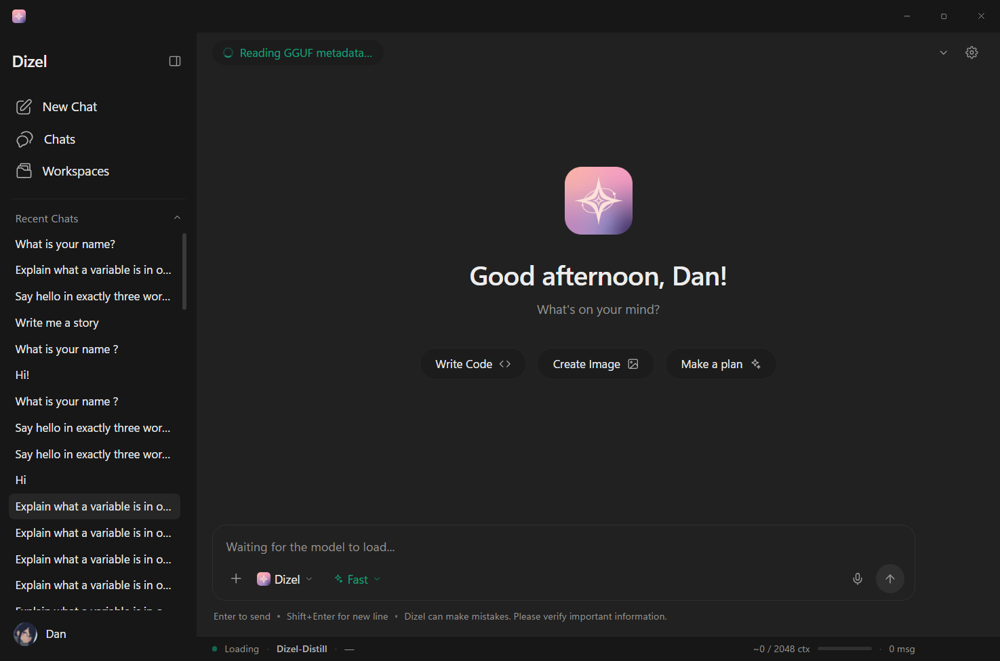

# Dizel Desktop

Electron + React + TypeScript shell for Dizel, replacing the PySide6 app in
`inference/dizel_gui/`.

The Python engine is **not** rewritten. `inference/dizel_gui/logic/` keeps
owning models, providers, token budgets and history; this app is a new face on
top of it, talking over a local HTTP sidecar.



---

## Design parity

The shell is matched against the **real** PySide6 app, not against a description
of it. `design-reference-pyside.png` is that app, rendered offscreen; `preview.png`
is this one. Every colour below was sampled from the reference rather than guessed:

| Token | Value | Where |
|---|---|---|
| chat surface | `#212121` | main column |
| chrome | `#171717` | title bar, sidebar, status pill |
| accent | `#0ea5e9` | send button, active chip, assistant name, status dot |
| border | `#303030` | composer, dividers |
| user bubble | `#2f2f2f` | right-aligned card |
| primary text | `#ececec` | body |
| dim text | `#939393` | hints, meta |

Type is Segoe UI, matching `theme/fonts.py`. Sizes follow the real app: 15px nav,
19px wordmark, 32px greeting, 14px body, 13.5px session rows.

Reproduce the reference capture with:

```bash
QT_QPA_PLATFORM=offscreen QT_QPA_FONTDIR="C:\Windows\Fonts" \
  python scripts/grab-pyside.py out.png
```

The font directory is not optional — the offscreen Qt backend ships no font
config, so without it every glyph renders as tofu.

---

## Run it

```bash
cd desktop
npm install

npm run dev      # Vite dev server + Electron with hot reload
npm run build    # typecheck + production bundle into dist/
npm run dist     # build + electron-builder NSIS installer into release/
```

### Prerequisites

A Python interpreter with the app's dependencies (`fastapi`, `uvicorn`,
`llama-cpp-python`, …). The Electron main process probes several candidates at
startup — `.venv`, `python` on PATH, `py -3`, then `%LOCALAPPDATA%\Programs\Python\Python3xx`
— and picks the first one that can import FastAPI. The winner is cached in
`%APPDATA%\dizel-desktop\python.json`.

Override it with `DIZEL_PYTHON`:

```bash
DIZEL_PYTHON="C:/path/to/python.exe" npm run dev
```

---

## How the three processes fit

```
Electron main (Node)          picks a free port, mints a token, spawns Python
      │                       owns the window, tray-free, frameless chrome
      ├── preload (isolated)  exposes exactly four things to the renderer
      │
      ├── renderer (React)    UI only. Never imports torch. Never reads disk.
      │
      └── Python sidecar      uvicorn + FastAPI on 127.0.0.1:<random>
            api/main.py       binds loopback only
            api/security.py   rejects anything without X-Dizel-Token
            api/services/     wraps ChatManager, ConfigManager, history_manager
                              │
                              └── inference/dizel_gui/logic/  (unchanged)
```

**Why the token matters.** The sidecar speaks HTTP on localhost. Without a
secret, any page you happen to have open could POST to it — and
`ChatManager.send_message` can execute shell commands via `/sh`. The token is
random per launch, held in main, and required on every route except
`/api/health`. `/sh` and `/py` are additionally disabled over HTTP unless the
sidecar is started with `DIZEL_ALLOW_SHELL=1`.

---

## Layout

```
desktop/
├── electron/
│   ├── main.cjs           window, sidecar lifecycle, IPC, CSP, self-check
│   └── preload.cjs        contextBridge surface (the only bridge)
├── src/
│   ├── components/        TitleBar, Sidebar, ChatView, MessageBubble, Composer, StatusBar
│   ├── services/          sidecar.ts (port+token), api.ts (REST + SSE)
│   ├── store/chatStore.ts single zustand store
│   ├── styles/tokens.css  three theme modes, ported from theme/colors.py
│   └── styles/app.css     reset, shell, markdown, syntax colours
└── scripts/check-chat.js  headless driver used by the screenshot check
```

### Icons and artwork

The sidebar and Workspaces menu use the desktop app's **own SVG files**, copied
from `inference/dizel_gui/assets/icons/` into `public/icons/`. They're drawn with
a hard-coded black stroke, so they're rendered as a CSS mask over `currentColor`
(`MaskIcon.tsx`) rather than as `` — that way they follow the theme and hover
states without editing the files.

| Element | Source |
|---|---|
| New Chat | `edit-3.svg` (20px) |
| Chats | `new-chat-2.svg` (22px) |
| Workspaces | `workspace-2.svg` (20px) |
| Workspaces menu | `image` `layout` `search` `archive` `book` `activity` (18px) |
| App icon | `public/Dizel_GUI.png`, `public/Dizel_GUI.ico` |
| Model mark | `public/Dizel.png`, `public/Mila.png` |

The app icon and model marks are real PNGs, not redrawn SVGs — each carries its
own alpha silhouette, so no CSS radius is applied on top. The composer's model
picker deliberately keeps the Dizel/Mila artwork instead of the app icon.

### Theme tokens
`theme/colors.py` stores every colour as `(light, dark, dark_blue)` and resolves
at draw time. `tokens.css` reproduces that as three `[data-theme]` blocks over
one set of variable names, so a component never knows which theme is active.
Cycle with the sparkles button in the title bar.

---

## What works today

- Frameless window with custom chrome, drag region, min/max/close
- Sidecar spawn, health poll, clean shutdown (taskkill /T on Windows)
- Auto-loads the configured checkpoint on launch; while it loads, the chat area
  shows a loader with the checkpoint name, the current stage and an elapsed
  counter (the backend reports stages, not percentages, so the bar is
  indeterminate on purpose)
- Streaming chat over SSE, token by token, into markdown bubbles
- Message anatomy matching the desktop app: "You" card, Dizel avatar and an
  accent-coloured name, Copy / Regenerate, timing and character meta
- Markdown + GFM tables + syntax-highlighted code with copy
- Session list from disk, click to reopen; `Chats` opens the sidebar view
- **Chat management** — every row has a `⋯` menu: Rename, Pin, Archive, Delete.
  Double-click a title to rename inline. Delete arms on the first click and fires
  on the second, so a stray click can't destroy a conversation. Pinned chats sort
  into their own group; the Chats view groups by Pinned / Today / Yesterday /
  This week / Older, and the sidebar grows a search box past six chats.
- **Archiving** — archived chats leave the sidebar but stay on disk, and the
  `Archived` workspace lists them for restore. The menu is `position: fixed` so
  the scrolling chat list can't clip it.
- **Export** — "Export JSON…" writes a chat through a native save dialog. The
  payload matches what the importer expects (`{title, messages[]}`), so a file can
  be re-imported as-is.
- **Provider refresh** — the model menu's provider header has a refresh control, so
  a model added in Ollama shows up without switching providers.
- **Context warning** — past 80% of the model's window, an amber banner appears
  above the composer explaining that older messages will start dropping, and the
  status-bar counter turns amber. Dismissible, re-armed per conversation. Both the
  banner and the status bar read the same `contextUsage()` helper, so they can't
  disagree.
- **Empty-state composer** — on a fresh chat the composer sits inside the welcome
  flow (greeting → composer → starters → recall), and stays in exactly the same
  place while the model loads: the loading state swaps only the block above the
  composer for a compact strip (spinner, stage, elapsed), keeping starters and
  recall below. Measured jump between states: 1px. It docks to the bottom as soon
  as the conversation starts. The logo above the greeting is gone.
- **No placeholder lies** — before `boot()` resolves, the composer's model and tier
  chips render as skeletons rather than the fabricated "Model" / "Dizel" fallbacks
  they used to show for the first second, and the status bar shows `—`.
- **Edit & resend** — hover a message you sent and hit Edit. The text returns to
  the composer with an "everything after it will be replaced" notice; sending
  truncates the saved session to that point first, so the model never sees the
  message that was just replaced.
- **Handoff** — that banner carries a "Continue in a new chat" button: the thread
  is summarised and a fresh chat opens seeded with the summary as a system note,
  rendered as a dashed "carried over" card. Uses the existing extractive
  `summarize_old_context` (no model call, so it can't invent a topic).
- **Recall** — the welcome screen lists the last three conversations under
  "Pick up where you left off", each showing its title and a short line from the
  **last reply** (`GET /memory/recent`), click to reopen. Not the prompt-fragment
  summariser — that text is for the model, not for reading.
- **Mode is visible** — the tier chip reads `Flash · Coding` (accent badge) when a
  non-default response mode is active, and its menu holds both Tier and Mode.
  Mode used to live only inside the `+` menu, where you couldn't see which was on.
- **Live reply state** — while streaming, the model mark **spins** a smooth 360° on
  a 1.8s loop until the reply finishes. Reply meta shows
  `1.3s · 240 chars · ~46 tok/s · 13:36` (throughput estimated at the same
  4 chars/token the context meter uses).
- **Ambient background** — two accent-tinted radial gradients drift slowly behind
  the chat on a 34s cycle. Animated by `background-position` rather than transform,
  so nothing bleeds outside the pane.
- **Transitions** — the welcome fades up on mount and the docked composer slides up
  when a conversation starts. All motion is off under `prefers-reduced-motion`.
- **Depth** — the model mark carries a drop shadow in the switcher, the message
  header and the provider rows.
- **Dictation model auto-download** — pressing the mic when no Whisper checkpoint
  is on disk starts the download automatically (it's ~145 MB, and pressing the mic
  *is* the request), with a strip above the composer showing
  `Downloading Whisper base — 41%`, a progress bar and Cancel. `GET /nova/download`
  is polled for progress; the transfer streams to `<size>.pt.part` and is renamed
  on completion, so an interrupted download never leaves a corrupt checkpoint.
  On success the strip says "click the mic" and dismisses itself after 4s.
- **Tray + hotkey** — tray icon from `public/Dizel_GUI.ico`, explicitly resized to
  32×32 before handing it to `Tray` (Windows picks a 256px frame from a multi-size
  .ico and falls back to its default icon otherwise). `BrowserWindow` sets the same
  `.ico`, so the taskbar isn't Electron's logo. Menu with Show / New chat / Quit,
  and `Ctrl+Shift+Space` summons or hides the window from anywhere.
- **Animated toggles** — the status bar and the recent-chats list stay mounted and
  transition their height (240ms / 300ms) instead of popping. Measured:
  `31 → 20 → 7 → 4 → 1 → 0` and `448 → 196 → 131 → 77 → 40 → 16 → 5 → 1 → 0`.
  The status bar can't use the `0fr` grid trick (a fixed-height child keeps its
  min-content size), so it transitions `height` directly.
- **Display settings** — 24-hour clock, show reply speed, and message font
  (System / Serif / Mono) alongside the existing accent and density.
- **Drag & drop** — drop files anywhere on the window to attach them. Uses
  `webUtils.getPathForFile` (Electron 32 removed `File.path`) and feeds the same
  ingest path as the `+` menu, so binary files are still refused.
- **Jump to latest** — scrolling up during a long reply stops the auto-follow and
  floats a "Latest" pill above the composer.
- **Chat titles** — derived from the first line of the prompt, markdown stripped
  and trimmed at a word boundary (`…`) instead of a raw 45-char cut.
- **Keyboard shortcuts** — `Ctrl+N` new chat, `Ctrl+K` focus composer, `Ctrl+B`
  toggle sidebar, `Ctrl+,` settings, `Esc` closes dialogs. All listed in
  Settings → Shortcuts.
- Sidebar wordmark carries the release tag reported by `/models/info` (`v1.5`
  today), so a new checkpoint updates it without a code change. The collapse
  button swaps between panel-collapse and panel-expand icons, and collapsing hides
  only the labels — the nav icons stay put.
- Icon buttons, starter pills, provider cards and the send circle all have spring
  hover/press motion (transform only, disabled with reduced-motion or
  *UI animations* off)
- **Content column** — stream, composer and error banner share one symmetric
  gutter (`--gutter-left` on both sides) and a `--content-max` of 1100px, so the
  composer fills the window instead of stopping short on the right. The old
  `--gutter-right: 100px` is only for the title bar, where the window controls are.
- Stop generation mid-stream
- Time-of-day greeting with the username from `settings.json`
- **Welcome starters** — Write Code / Explain a concept / Make a plan. Text-only on
  purpose: Dizel 1.6 Flash Preview has no vision encoder, so an image starter would
  promise something the model cannot do.
- **Status bar** — state, model, params, device, approximate context usage with a
  fill meter, message count. Toggle it from the chevron in the header.
- **Reasoning blocks** — `<think>` / `<thinking>` are stripped from the answer and
  shown in a collapsible "Reasoning" panel; an unterminated block reads "Thinking…"
  while streaming
- **Settings** — two-pane dialog (left nav, flat sections separated by hairlines,
  sticky footer) with five tabs:
  - *Chat*: checkpoint picker + browse, device (disabled with a reason when CUDA
    isn't detected), GGUF chat format, the desktop app's 4-column provider card
    grid with encrypted key entry, system prompt, five sampling sliders with reset.
    **Ollama** discovers the models you've pulled (`GET /providers/models`) and
    activates on click — if the daemon isn't up, the row says so instead of failing
    silently. **Custom Provider** needs a name, an OpenAI-compatible base URL and a
    key; "Save & connect" stores them, pulls the model list from that endpoint and
    activates the first model.
  - *Model*: architecture, training data and capabilities, read from `model/dizel_info.py`
  - *Appearance*: colour mode, font scale, **accent** (blue / teal / violet /
    rose), **density** (comfortable / compact), and five display toggles — **all
    of which are actually applied** (see below)
  - *Speech*: Whisper model size and language, honoured by the transcribe route
  - *Shortcuts*: the live keybindings, with `kbd` chips
  - *About*: version and build, repository link, a Runtime block (checkpoint,
    device, saved chats, build), and clear-all-chats behind a confirm

Every control in Settings is wired to something. That wasn't true before: seven
appearance keys were being written to `settings.json` and read by nothing. They
now flow through `prefs` in the store and take effect on save — font scale is real
browser zoom via `webFrame.setZoomFactor`, and "UI animations" off sets
`:root[data-motion="off"]`, which mirrors the `prefers-reduced-motion` rule.
- **Workspaces** — the secondary sidebar with seven views: Chats (search + import),
  Riset (global search), Library (saved prompts), Monitor (live CPU/RAM), plus
  Image / Archived / Presentation as labelled empty states
- **Model switcher** — two chips in the composer. The **model** chip lists the
  local checkpoint (`Local · 454.8M · CPU`) plus every model the active provider
  offers, grouped under the provider name, with a check on the active one and a
  "Manage models…" link into Settings. The **tier** chip (Flash / Pro) only
  appears while the local model is active — provider models keep their own
  prompts and budgets.
- **Variant picker** — Dizel 1.6's **Flash** and **Pro** tiers. The backend also
  keeps the legacy `Dizel`/`Mila` profiles so the PySide6 GUI still runs; the
  composer filters them out.
- **`+` menu** — one place for attachments and response mode:
  - *Files…*, *Folder…* (top-level text files, max 12), *Images…* (see note below)
  - *Mode*: Fast / Planning / Coding / Thinking
  The `+` shows an accent dot whenever the mode isn't Fast.
- **Profile** — click the avatar in the sidebar for a banner-headed dialog: change
  the photo, remove it, edit the display name (with a live preview of the greeting).
  Stored next to `settings.json`, served over an authenticated route and handed to
  the renderer as an object URL (the CSP allows `blob:` for this).
- **Attachments**: `+` reads a text file (4 files, 6k chars each) and folds it into
  the prompt. Chips show a type badge, size and truncation; clicking one opens a
  preview of the contents. **Binary files are refused** — decoding a PNG as UTF-8
  would inject mojibake into the prompt, which is worse than saying no.
- **Dictation**: mic records 16 kHz WAV, posts to `/api/nova/transcribe`
- Three themes, persisted

## Startup and loading states

The window opens with `backgroundColor: #212121` and `show: false` until
`ready-to-show`, so there's no white flash before the first paint.

After that, the shell renders **immediately** and previews its own layout while
the sidecar boots:

| Moment | What you see |
|---|---|
| Sidecar starting | Header pill "Starting Dizel…" with a spinner; shimmer rows where the chat list will be; shimmer bars standing in for the greeting, subtitle and the three starter pills; composer reads "Starting Dizel…" |
| Model loading | Green pill with the backend's load message, plus an indeterminate progress bar under the header |
| Ready | Real content fades in; pill turns into model · params · device |

Shimmer is a CSS gradient sweep (`.skel`), and every animation is disabled under
`prefers-reduced-motion`.

## Feature parity with the PySide6 app

Honest audit. "Partial" means it exists but is thinner than the original.

| Feature | State |
|---|---|
| Local inference (.gguf) | Yes — verified |
| Local inference (.pt, .safetensors) | Wired through the same backend, **untested** |
| 12 API providers + custom | UI + encrypted key storage yes; **no live call tested** (needs a key) |
| Model listing per provider | No — type the model id by hand |
| Markdown, code blocks, copy | Yes |
| Collapsible `<think>` blocks | Yes |
| Copy / Regenerate | Yes |
| Like / dislike / share / edit message | **No** |
| Stop generation | Yes |
| Attachments | Text only; binary refused, click-to-preview. **Images not sendable yet** |
| Web search / Deep think / Parse files toggles | **No** |
| Variant + mode switching | Yes |
| Verbosity (short/normal/detailed) | **No** |
| Slash commands (`/sh`, `/read`, `/py`, `/fetch`) | Backend has them; blocked over HTTP, no UI |
| Sessions: save / load / open | Yes |
| Rename, pin, tag sessions | **No** (backend supports pin) |
| Export chat | **No** (import yes) |
| Nova dictation | Yes |
| Waveform + silence auto-submit | **No** |
| Command palette (Ctrl+K) | **No** |
| First-run tutorial | **No** |
| Drag & drop attachments | **No** |
| Profile dialog / avatar upload | Yes |
| Usage meter / 12-hour budget UI | **No** (backend still budgets) |
| Context trimming | Yes, automatic in the backend |
| Monitor (CPU/RAM) | Yes |
| Theme: system mode | **No** — dark / light / dark-blue only |
| Font scale, timestamps, avatar toggles | Yes — applied on save |
| Packaging (`npm run dist`) | Configured, untested |

## Not ported yet

Roughly in the order I'd do them:

1. **`<think>` blocks and the rest of the message action bar** — like/dislike/share/edit.
2. **Web search / Deep think / Parse files** — the backend has `core/tools` and
   `send_message_with_tools`; it needs an endpoint and a chip row.
3. **Verbosity control** and a usage meter.
4. **Session management** — rename, pin, export.
5. **Command palette** and keyboard shortcuts.
6. **Waveform + silence auto-submit** for dictation.
7. **Packaging.**

---

## Headless self-check

Useful for verifying the UI without watching the screen:

```bash
DIZEL_PROD=1 \
DIZEL_SHOT=out.png \
DIZEL_SHOT_DELAY=3000 \
DIZEL_SHOT_JS_FILE=scripts/check-chat.js \
DIZEL_DEBUG=1 \
npx electron . --disable-gpu
```

`DIZEL_SHOT` captures the window and exits. `DIZEL_SHOT_JS_FILE` runs a script
in the renderer first and logs whatever it returns — `check-chat.js` waits for
the model, sends a real message, and reports the result. `DIZEL_DEBUG=1`
exposes the store as `window.__dizel` for that script to drive.

---

## Gotchas

- **`Cannot read properties of undefined (reading 'isPackaged')`** means
  Electron ran as plain Node. Unset `ELECTRON_RUN_AS_NODE` before launching.
- **`DIZEL_PROD=1`** loads the built `dist/` instead of the dev server. Needed
  when testing a production build unpackaged.
- The renderer loads from `file://` in production, so `vite.config.ts` sets
  `base: './'`. Absolute asset paths will 404.
- CSP is only injected in packaged builds; the Vite dev server needs a looser
  policy for its HMR preamble.
